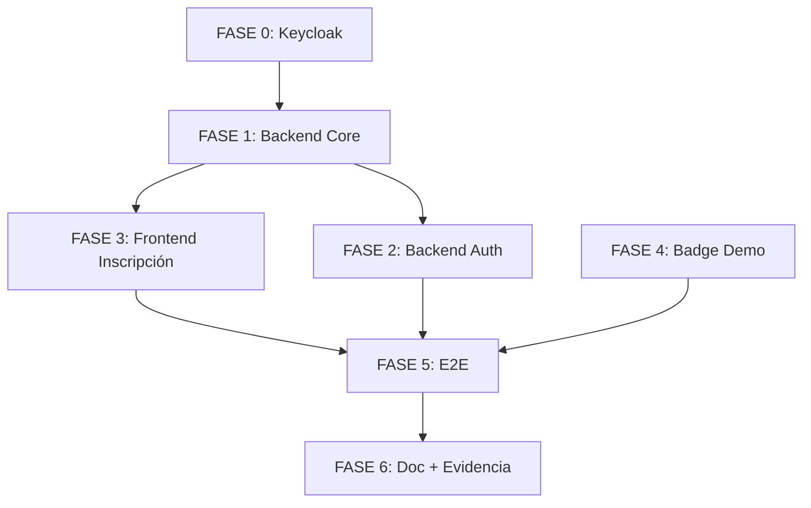

# Plan de Implementación — Spec 027

**Spec**: `027-portal-central-cuenta-paciente-persistente`
**Fecha**: 2026-09-18
**Estado**: `Borrador` (pendiente aprobación PO tras spec aprobada)

---

## 1. Estrategia General

**Enfoque**: Implementación por capas, de abajo hacia arriba (BD → Backend → Frontend → Integración E2E), validando cada capa antes de subir.

**Orden de ejecución**:
1. **Fase 0**: Preparación Keycloak (infra) — paralelo con Fase 1
2. **Fase 1**: Backend Core (BD + Provisión cuenta + Keycloak Admin API)
3. **Fase 2**: Backend Auth (Migración sesión + TTL + Auditoría)
4. **Fase 3**: Frontend Inscripción (Campo password + validación)
5. **Fase 4**: Frontend Portal (Badge demo — solo visual)
6. **Fase 5**: Integración E2E + Tests + Verificación manual
7. **Fase 6**: Documentación + Evidencia para auditoría

**Principio**: Cada fase debe tener tests pasando antes de continuar. No mezclar cambios visuales y funcionales en el mismo commit.

---

## 2. Desglose por Fases

### FASE 0 — Preparación Keycloak (Infraestructura)
**Duración estimada**: 30 min
**Responsable**: DevOps / Codex (script)
**Archivos**: `docker-compose.yml`, `tools/keycloak-bootstrap/` (nuevo)

| Tarea | Descripción | Done Criteria |
|-------|-------------|---------------|
| 0.1 | Verificar Keycloak corriendo en Docker (`docker ps | grep keycloak`) | Container `keycloak` UP, puerto 8080 accesible |
| 0.2 | Crear realm `merdn-patient` via Admin API o console | Realm existe en `http://localhost:8080/admin/master/console/#/merdn-patient` |
| 0.3 | Crear client `merdn-patient-client` (confidential, Standard Flow + Direct Grants + Service Accounts) | Client ID/Secret generados, redirect URIs configurados |
| 0.4 | Crear service account con role `manage-users` (realm-management) | Admin API puede crear usuarios |
| 0.5 | Documentar variables de entorno en `.env.example` | `KEYCLOAK_ADMIN_URL`, `KEYCLOAK_ADMIN_USER`, `KEYCLOAK_ADMIN_PASSWORD`, `KEYCLOAK_PATIENT_REALM`, `KEYCLOAK_PATIENT_CLIENT_ID`, `KEYCLOAK_PATIENT_CLIENT_SECRET`, `KEYCLOAK_ISSUER_URL` |
| 0.6 | Healthcheck Keycloak en CI (`curl -f http://keycloak:8080/realms/merdn-patient/.well-known/openid-configuration`) | CI pasa |

**Nota**: Si Keycloak ya existe en `docker-compose.yml` con realm `master` usado por institucional, **crear realm separado `merdn-patient`** para aislar pacientes. No mezclar.

---

### FASE 1 — Backend Core: Provisión Cuenta en Inscripción
**Duración estimada**: 2-3 horas
**Responsable**: Backend (Claude Code)
**Archivos principales**: 
- `apps/api/src/patients/patient-enrollment.service.ts`
- `apps/api/src/patients/patient-enrollment.controller.ts`
- `apps/api/src/patients/patient-enrollment.dto.ts`
- `apps/api/src/patients/enrollment.validation.ts`
- `apps/api/src/config/environment.ts` (nuevas vars Keycloak)
- `apps/api/src/patients/keycloak-admin.client.ts` (nuevo)

#### 1.1 Cliente Keycloak Admin API (Nuevo Archivo)
**Archivo**: `apps/api/src/patients/keycloak-admin.client.ts`

```typescript
// Responsabilidad única: crear usuario en Keycloak
// - Recibe access token de service account (client credentials grant)
// - Llama POST /admin/realms/{realm}/users
// - Devuelve userId (subject) o lanza KeycloakProvisionError
// - Timeout 10s, retry 1x
```

#### 1.2 Validación Password (enrollment.validation.ts)
```typescript
// Añadir a validateEnrollmentRequest():
// - password?: string (opcional, nullable para compatibilidad)
// - Si presente: minLength 8, regex /[a-zA-Z]/, regex /\d/
// - No hash aquí — Keycloak hashea
```

#### 1.3 DTO (patient-enrollment.dto.ts)
```typescript
// PatientEnrollmentRequestDto: añadir @IsOptional() @IsString() @MinLength(8) password?: string
```

#### 1.4 Servicio (patient-enrollment.service.ts) — Cambio Crítico
**En `enroll()`, dentro de `prisma.withTenant()` transacción (tras `patient.create`, antes de `return`)**:

```typescript
// 1. Generar subject UUID v4 (predecible para ExternalAuthIdentity)
const keycloakSubject = randomUUID();

// 2. Crear HumanAccount
const humanAccount = await tx.humanAccount.create({
  data: { tenantId, personId: person.id, status: 'ACTIVE' },
  select: { id: true },
});

// 3. Crear ExternalAuthIdentity PENDING_LINK
const extAuth = await tx.externalAuthIdentity.create({
  data: {
    tenantId,
    humanAccountId: humanAccount.id,
    issuer: keycloakIssuerUrl, // de config
    subject: keycloakSubject,
    status: 'ACTIVE', // o nuevo status 'PENDING_LINK' si se prefiere
  },
  select: { id: true },
});

// 4. Llamar Keycloak Admin API (FUERA de transacción BD pero ANTES de commit)
//    Usar keycloakAdminClient.createUser({...})
//    Si falla → throw KeycloakProvisionError() → rollback automático

// 5. (Opcional) Actualizar extAuth.status = 'ACTIVE' si se usó PENDING_LINK

// 6. Auditar HUMAN_ACCOUNT_CREATED + HUMAN_IDENTITY_LINKED
await this.audit.recordHumanAccountCreatedWithin(tx, context, { humanAccountId: humanAccount.id, personId }, now);
await this.audit.recordHumanIdentityLinkedWithin(tx, context, { extAuthIdentityId: extAuth.id, humanAccountId: humanAccount.id, issuer: keycloakIssuerUrl, subject: keycloakSubject }, now);
```

#### 1.5 Configuración (environment.ts)
```typescript
// Nuevas vars requeridas:
KEYCLOAK_ADMIN_URL
KEYCLOAK_ADMIN_USER
KEYCLOAK_ADMIN_PASSWORD
KEYCLOAK_PATIENT_REALM
KEYCLOAK_PATIENT_CLIENT_ID
KEYCLOAK_PATIENT_CLIENT_SECRET
KEYCLOAK_ISSUER_URL
// Validación en loadApiEnvironment()
```

#### 1.6 Tests Unitarios (Nuevos / Actualizados)
| Archivo | Tests |
|---------|-------|
| `patient-enrollment.service.test.ts` | `enroll()` crea HumanAccount + ExternalAuthIdentity; rollback si Keycloak falla (mock) |
| `enrollment.validation.test.ts` | password opcional; si presente: válido/inválido |
| `keycloak-admin.client.test.ts` | createUser éxito / error / timeout |

---

### FASE 2 — Backend Auth: Migración Sesión + TTL + Auditoría
**Duración estimada**: 1-2 horas
**Responsable**: Backend (Claude Code)
**Archivos principales**:
- `apps/api/src/human-auth/human-auth.service.ts`
- `apps/api/src/human-auth/human-auth.config.ts`
- `apps/api/src/audit/audit.service.ts`
- `prisma/schema.prisma` (migración)

#### 2.1 Migración BD — Enum AuditEventType
**Archivo**: `prisma/schema.prisma` (línea ~179)
```prisma
enum AuditEventType {
  // ... existentes ...
  HUMAN_ACCOUNT_CREATED
  HUMAN_IDENTITY_LINKED
  ENROLLMENT_SESSION_REVOKED  // NUEVO
}
```
**Comando**: `npx prisma migrate dev --name add_enrollment_session_revoked_audit`

#### 2.2 AuditService — Nuevos Métodos
**Archivo**: `apps/api/src/audit/audit.service.ts`
```typescript
async recordHumanAccountCreatedWithin(tx, context, { humanAccountId, personId }, now)
async recordHumanIdentityLinkedWithin(tx, context, { extAuthIdentityId, humanAccountId, issuer, subject }, now)
async recordEnrollmentSessionRevokedWithin(tx, context, { enrollmentSessionId, patientId }, now)
// Todos: insert en audit_event con actorType=PUBLIC_SELF_ENROLLMENT o SYSTEM/HUMAN_ACCOUNT
```

#### 2.3 HumanAuthService — Migración en completeLogin()
**Archivo**: `apps/api/src/human-auth/human-auth.service.ts`, método `establishSession()` o `completeLogin()` (tras crear `HumanSession`):

```typescript
// Dentro de la transacción de establishSession(), tras tx.humanSession.create():
if (principal.personId) {
  const enrollmentSession = await tx.enrollmentSession.findFirst({
    where: {
      patient: { personId: principal.personId },
      tenantId: principal.tenantId,
      revokedAt: null,
      expiresAt: { gt: now },
    },
  });
  if (enrollmentSession) {
    await tx.enrollmentSession.update({
      where: { id: enrollmentSession.id },
      data: { revokedAt: now },
    });
    await this.audit.recordEnrollmentSessionRevokedWithin(
      tx,
      { tenantId: principal.tenantId, endpoint: '/api/v1/human-auth/callback', correlationId },
      { enrollmentSessionId: enrollmentSession.id, patientId: enrollmentSession.patientId },
      now,
    );
  }
}
```

#### 2.4 TTL Sesión Paciente (Config)
**Archivo**: `apps/api/src/human-auth/human-auth.config.ts`
```typescript
// En loadHumanAuthConfig() o HumanAuthConfig:
sessionTtlSeconds: 30 * 24 * 60 * 60,   // 30 días (2.592.000s)
sessionIdleSeconds: 72 * 60 * 60,       // 72 horas (259.200s)
// O leer de env var: HUMAN_AUTH_SESSION_TTL_SECONDS, HUMAN_AUTH_SESSION_IDLE_SECONDS
```

#### 2.5 Tests Unitarios
| Archivo | Tests |
|---------|-------|
| `human-auth.service.test.ts` | `completeLogin()` revoca enrollment_session si existe; auditoría ENROLLMENT_SESSION_REVOKED |
| `audit.service.test.ts` | 3 nuevos métodos registran campos correctos |

---

### FASE 3 — Frontend Inscripción: Campo Password
**Duración estimada**: 1.5-2 horas
**Responsable**: Frontend (Claude Code)
**Archivos principales**:
- `apps/web/src/features/inscripcion/steps/PasosPaciente.tsx`
- `apps/web/src/features/inscripcion/inscripcionFlow.ts`
- `apps/web/src/features/inscripcion/patientEnrollmentClient.ts`
- `apps/web/src/features/inscripcion/patientEnrollmentClient.test.ts`

#### 3.1 Tipo de Datos (inscripcionFlow.ts)
```typescript
// DatosPaciente: añadir password?: string (nullable)
```

#### 3.2 Paso 2 — Contacto (PasosPaciente.tsx)
**Ubicación**: Componente que renderiza paso 2 de paciente (email/teléfono).
**Añadir**:
```tsx
<div className={styles.field}>
  <label htmlFor={idCampo('password')}>Contraseña</label>
  <div className={styles.passwordWrapper}>
    <input
      type={showPassword ? 'text' : 'password'}
      id={idCampo('password')}
      value={valores.password ?? ''}
      onChange={...}
      onBlur={...}
      aria-describedby={`${idCampo('password')}-help`}
      autoComplete="new-password"
    />
    <button type="button" onClick={() => setShowPassword(!showPassword)} aria-label={showPassword ? 'Ocultar contraseña' : 'Mostrar contraseña'}>
      {showPassword ? '🙈' : '👁️'}
    </button>
  </div>
  <p id={`${idCampo('password')}-help`} className={styles.fieldHelp}>
    Mínimo 8 caracteres, al menos una letra y un número.
  </p>
  {/* Indicador fortaleza visual */}
  <div className={styles.strengthBar} role="progressbar" aria-valuenow={strength} aria-valuemin={0} aria-valuemax={3} aria-label="Fortaleza de contraseña">
    <div className={`${styles.strengthFill} ${strengthClass}`} style={{ width: `${(strength/3)*100}%` }} />
  </div>
  {error && <FieldError id={`${idCampo('password')}-error`}>{error}</FieldError>}
</div>
```

#### 3.3 Validación Cliente (en paso 2 `siguiente`)
```typescript
// En dispatch 'siguiente' o validación paso 2:
if (password && (password.length < 8 || !/[a-zA-Z]/.test(password) || !/\d/.test(password))) {
  dispatch({ type: 'setError', campo: 'password', mensaje: 'La contraseña debe tener al menos 8 caracteres, una letra y un número.' });
  return;
}
```

#### 3.4 Cliente API (patientEnrollmentClient.ts)
```typescript
// buildPatientEnrollmentRequest(): añadir password al request si presente
// submitPatientEnrollment(): enviarlo en body (Keycloak lo hashea)
```

#### 3.5 Tests
| Archivo | Tests |
|---------|-------|
| `PasosPaciente.test.tsx` | Paso 2 renderiza password, toggle, fortaleza, validación, error accesible |
| `patientEnrollmentClient.test.ts` | Request incluye password; tipos correctos |

---

### FASE 4 — Frontend Portal: Badge Demo (Solo Visual)
**Duración estimada**: 30 min
**Responsable**: Frontend (Claude Code)
**Archivos**:
- `apps/web/src/features/hub/HubAccessPortal.tsx`
- `apps/web/src/features/hub/hub.module.css`

#### 4.1 HubAccessPortal.tsx
En cada una de las 4 tarjetas institucionales (Alcaldía, Hospital, Personal Terreno, Médicos), en `cardHeader` tras `cardTag`:

```tsx
<div className={styles.cardMeta}>
  <span className={styles.cardTag}>Gobierno & Territorio</span>
  <h3 className={styles.cardTitle}>Alcaldía de Soacha</h3>
  <span className={styles.demoBadge}>Datos de demostración</span>  {/* NUEVO */}
</div>
```

#### 4.2 hub.module.css
```css
.demoBadge {
  display: inline-block;
  margin-top: 4px;
  padding: 2px 8px;
  font-size: 11px;
  font-weight: 600;
  color: var(--b-gris-oscuro);
  background: var(--b-gris-claro);
  border-radius: 999px;
  white-space: nowrap;
}
```

#### 4.3 Test Visual
- Snapshot test o inspección manual en `/` — 4 badges visibles, sin romper layout.

---

### FASE 5 — Integración E2E + Tests Completos
**Duración estimada**: 2-3 horas
**Responsable**: Full Stack (Claude Code)

#### 5.1 Tests Integración API
| Endpoint | Escenarios |
|----------|------------|
| `POST /patients/enrollments` | 201 + BD correcta; 400 password inválido; 409 duplicado; 500 Keycloak down |
| `GET /human-auth/session?context=PATIENT` | 200 activa-con-contexto; 401; 403 |
| `POST /human-auth/login` | Redirect Keycloak; callback completa |

#### 5.2 Test E2E (Playwright / Vitest + Testing Library)
**Flujo completo**:
1. Navegar a `/inscripcion`
2. Elegir "Paciente"
3. Completar 5 pasos (paso 2 con password válido)
4. "Terminar inscripción" → ver "Inscripción completada"
5. Click "Ingresar como Paciente" → redirect Keycloak login
6. Login con email/password creados
7. Redirect a `/` → `PacienteExperience` carga resumen/citas/visitas
8. **F5** → sigue logueado
9. **Cerrar navegador, reabrir** → sigue logueado (si <72h idle)

#### 5.3 Verificación BD (Script)
```bash
# Ejecutar tras test E2E
npx prisma db execute --file ./scripts/verify-patient-account.sql
```
```sql
-- verify-patient-account.sql
SELECT p.documentNumber, p.givenNames, p.familyNames,
       ha.id as human_account_id, ha.status,
       eai.id as ext_auth_id, eai.issuer, eai.subject, eai.status,
       es.id as enrollment_session_id, es.revokedAt,
       hs.id as human_session_id, hs.expiresAt, hs.revokedAt
FROM person p
JOIN patient pa ON pa.personId = p.id
LEFT JOIN human_account ha ON ha.personId = p.id
LEFT JOIN external_auth_identity eai ON eai.humanAccountId = ha.id
LEFT JOIN enrollment_session es ON es.patientId = pa.id
LEFT JOIN human_session hs ON hs.humanAccountId = ha.id
WHERE p.documentNumber = 'TEST_DOC_123';
```

#### 5.4 Verificación Auditoría
```sql
SELECT eventType, actorType, resourceType, resourceId, occurredAt
FROM audit_event
WHERE eventType IN ('HUMAN_ACCOUNT_CREATED','HUMAN_IDENTITY_LINKED','HUMAN_SESSION_CREATED','ENROLLMENT_SESSION_REVOKED')
ORDER BY occurredAt DESC
LIMIT 10;
```

#### 5.5 Accesibilidad
- `npm run test:a11y` (axe-core en páginas `/inscripcion`, `/`, `/inscripcion` paso 2)
- Navegación teclado manual (Tab, Enter, Escape)
- NVDA/VoiceOver: anuncios de carga, error, éxito

---

### FASE 6 — Documentación + Evidencia para Auditoría
**Duración estimada**: 1 hora
**Responsable**: Codex + Claude Code

| Entregable | Formato |
|------------|---------|
| `git diff` completo | Output terminal |
| Tests passing | `vitest run` output (web + api) |
| Verificación BD | SQL output (tablas person, patient, human_account, external_auth_identity, enrollment_session, human_session, audit_event) |
| E2E documentado | Capturas pantalla / video corto (1-2 min) |
| Accesibilidad | Reporte axe-core (JSON/HTML) |
| Changelog | Entrada en `CHANGELOG.md` o `spec/bitacora/` |

---

## 3. Dependencias entre Fases



- **Fase 0 y 1 pueden ir en paralelo** (Keycloak infra vs código backend).
- **Fase 4 (badge)** es independiente — puede hacerse en cualquier momento.
- **Fase 5 requiere Fases 1-4 completas**.

---

## 4. Riesgos y Mitigaciones

| Riesgo | Probabilidad | Impacto | Mitigación |
|--------|--------------|---------|------------|
| Keycloak Admin API no responde / timeout | Media | Alto (bloquea inscripción) | Timeout 10s + retry 1x; healthcheck en CI; circuit breaker futuro |
| Keycloak `createUser` falla por validación (email duplicado, etc.) | Baja | Medio | Validar email único en BD antes de llamar Keycloak (ya hay unique constraint en person.email? No — solo documentNumber. Añadir check email si business rule lo requiere) |
| Migración `enrollment_session` no encuentra sesión (ya expirada) | Baja | Bajo | Código defensivo: `if (enrollmentSession) { revocar }` — no es error si no existe |
| TTL 30d/72h afecta a profesional (sesiones muy largas) | Media | Medio | Si es problema, añadir config por contexto en Fase 2.1 (post-MVP) |
| Tests E2E flaky por Keycloak redirect | Media | Medio | Mock Keycloak en tests unit/integración; E2E real solo en CI con Keycloak real |

---

## 5. Criterios de "Done" por Fase

| Fase | Done Criteria |
|------|---------------|
| 0 | Keycloak realm/client creados, vars en `.env.example`, healthcheck CI verde |
| 1 | `POST /enrollments` 201 crea HumanAccount + ExternalAuthIdentity + Keycloak user; tests unitarios pasan |
| 2 | Migración BD aplicada; `completeLogin()` revoca enrollment_session; auditoría 4 eventos; TTL configurado; tests pasan |
| 3 | Paso 2 muestra password + toggle + fortaleza; validación cliente; request incluye password; tests pasan |
| 4 | 4 badges visibles en `/`; sin regresión visual; snapshot test pasa |
| 5 | E2E completo verde; verificación BD + auditoría correcta; a11y 0 violations críticos |
| 6 | Evidencia completa entregada a Codex para auditoría |

---

## 6. Comandos de Validación (Pre-commit / CI)

```bash
# Backend
cd apps/api
npm run lint
npm run typecheck
npm test -- --run

# Frontend
cd apps/web
npm run lint
npm run typecheck
npm test -- --run

# E2E (requiere Keycloak + API + Web corriendo)
npm run test:e2e

# Accesibilidad
npm run test:a11y

# Migración BD
npx prisma migrate status
npx prisma migrate dev --name add_enrollment_session_revoked_audit
```

---

## 7. Rollback Plan

Si algo falla en producción (post-merge a `develop`):

1. **Código**: `git revert <commit-sha>` o `git reset --hard <tag-previo>` + force push a `develop` (autorizado por PO).
2. **BD**: Migración Prisma reversible (`npx prisma migrate resolve --rolled-back <name>`). Datos no se borran.
3. **Keycloak**: Usuarios creados quedan huérfanos — script de limpieza manual si se requiere.
4. **Datos**: `person`, `patient`, `human_account`, `external_auth_identity`, `enrollment_session`, `audit_event` **persisten** — no hay pérdida de información de paciente.

---

## 8. Aprobación del Plan

**Firma Product Owner**: _________________________ **Fecha**: _______________

**Firma Codex (Lead Architect)**: _________________________ **Fecha**: _______________