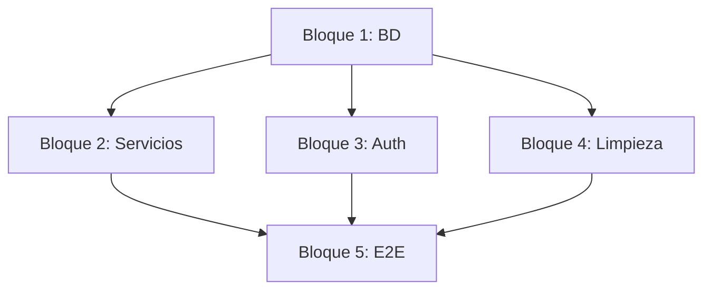

# Plan de Implementación — Spec 028

**Spec**: `028-identidad-humana-completar`
**Fecha**: 2026-09-19
**Estado**: `Aprobado` (consentimiento registrado el 2026-09-19)

---

## 1. Estrategia General

**Enfoque**: Implementación por bloques funcionales, validando cada uno con tests antes de pasar al siguiente. Priorizar gaps que desbloquean otros (base de datos → servicios → tests → jobs).

**Orden de ejecución**:
1. **Bloque 1 - Base de Datos** (RF-01, RF-04): Jobs BD + Tests BD garantías
2. **Bloque 2 - Servicios Compartidos** (RF-02): Refactor Visitas → IdentityAccessService
3. **Bloque 3 - Autenticación y Rate Limit** (RF-03, RF-05): OIDC happy-path + Rate limit Redis
4. **Bloque 4 - Limpieza y Tests** (RF-06, RF-07, RF-08): Limpieza, provisioning, tests no-skip
5. **Bloque 5 - Integración E2E + Evidencia**: Tests E2E + Evidencia auditoría

---

## 2. Desglose por Bloques

### BLOQUE 1 — Base de Datos: EXPIRED + Tests BD
**Duración estimada**: 4-6 horas
**Responsable**: Backend (Claude Code)

| Tarea | Descripción | Done Criteria |
|-------|-------------|---------------|
| 1.1 | Crear job nocturno expiración relaciones (`status = 'EXPIRED'` donde `endsAt < NOW()`) | Job corre, actualiza BD, logs visibles |
| 1.2 | Crear test BD: exclusion constraint `patient_caregiver_relationship_active_overlap` | Test pasa: constraint rechaza solapamiento |
| 1.3 | Crear test BD: trigger `prevent_self_caregiver_relationship` | Test pasa: trigger rechaza autorrelación |
| 1.4 | Crear test BD: RLS en 6 tablas (`human_account`, `external_auth_identity`, `human_session`, `human_auth_attempt`, `patient_caregiver_relationship`, `patient_caregiver_relationship_scope`) | Tests pasan: tenant A no ve tenant B |
| 1.5 | Crear test BD: grants sin DELETE en 6 tablas | Test pasa: DELETE falla |

**Archivos nuevos/modificados**:
- `apps/api/src/people-relationships/` (job expiración)
- `apps/api/test/identity-relationships-db.test.ts` (nuevo)
- `package.json` (dependencia `node-cron`)

---

### BLOQUE 2 — Servicios Compartidos: Visitas → IdentityAccessService
**Duración estimada**: 3-4 horas
**Responsable**: Backend (Claude Code)

| Tarea | Descripción | Done Criteria |
|-------|-------------|---------------|
| 2.1 | Refactor `professional-visit-query.service.ts` → usar `IdentityAccessService.resolveProfessional()` + `hasActiveAssignmentOverPatient()` | Mismo comportamiento, código usa servicio compartido |
| 2.2 | Refactor `professional-visit-worklist.service.ts` → usar `IdentityAccessService` | Igual |
| 2.3 | Refactor `home-visit-transition.service.ts` → usar `IdentityAccessService` | Igual |
| 2.4 | Tests regresión: worklist, materialización, transiciones | Tests existentes pasan |

**Archivos modificados**:
- `apps/api/src/visits/professional-visit-query.service.ts`
- `apps/api/src/visits/professional-visit-worklist.service.ts`
- `apps/api/src/visits/home-visit-transition.service.ts`
- Tests existentes en `apps/api/test/visits-*.test.ts`

---

### BLOQUE 3 — Autenticación y Rate Limit
**Duración estimada**: 4-5 horas
**Responsable**: Backend (Claude Code)

| Tarea | Descripción | Done Criteria |
|-------|-------------|---------------|
| 3.1 | Test OIDC happy-path: login → callback → sesión → `GET /human-auth/session` → contextos | Test pasa contra Keycloak local |
| 3.2 | Rate limit → Redis: migrar `human-auth-rate-limit.guard.ts` a `ioredis` + `REDIS_URL` | Rate limit funciona en multi-instancia |
| 3.3 | Config Redis: `REDIS_URL` env var, `ioredis` dependency | `npm install ioredis` + env var |
| 3.4 | Test rate limit Redis: exceder límite → 429 | Test pasa |

**Archivos nuevos/modificados**:
- `apps/api/src/human-auth/human-auth-rate-limit.guard.ts`
- `apps/api/test/human-auth.api.test.ts` (nuevo test happy-path)
- `package.json` (`ioredis`)
- `.env.example` (`REDIS_URL`)

---

### BLOQUE 4 — Limpieza, Provisioning, Tests No-Skip
**Duración estimada**: 3-4 horas
**Responsable**: Backend (Claude Code)

| Tarea | Descripción | Done Criteria |
|-------|-------------|---------------|
| 4.1 | Job limpieza `HumanAuthAttempt`: borrar `consumedAt IS NOT NULL` o `expiresAt < NOW() - 24h` | Job corre, BD limpia, logs |
| 4.2 | Tests provisioning → PostgreSQL real (quitar memoria) | Tests pasan contra BD real |
| 4.3 | Quitar `describe.skipIf(!puedeEjecutarse)` en tests BD → fail explícito si no hay BD | Tests fallan sin BD (no skip) |
| 4.4 | Test provisioning `identity:provision` contra BD real | Test pasa |

**Archivos modificados**:
- `apps/api/src/human-auth/` (job limpieza)
- `tools/identity-provisioning/src/operations.test.ts`
- `apps/api/test/eloisa-admin-support-foundation.db.test.ts` (quitar skipIf)
- `apps/api/test/human-auth.api.test.ts` (quitar skipIf)
- `package.json` (node-cron para jobs)

---

### BLOQUE 5 — Integración E2E + Evidencia
**Duración estimada**: 2-3 horas
**Responsable**: Full Stack (Claude Code)

| Tarea | Descripción | Done Criteria |
|-------|-------------|---------------|
| 5.1 | Test E2E: Login OIDC → sesión → Visitas worklist (profesional) | Playwright test pasa |
| 5.2 | Verificar job expiración relaciones funciona (logs + BD) | Logs + BD verificada |
| 5.3 | Verificar rate limit Redis funciona (429 tras exceder) | Test manual + logs |
| 5.4 | Generar evidencia auditoría (git diff, test outputs, logs) | Archivos en `evidence/` |

---

## 3. Dependencias entre Bloques



- **Bloque 1** es base: tests BD validan que la base soporta los gaps
- **Bloque 2** y **3** pueden ir en paralelo tras Bloque 1
- **Bloque 4** puede ir en paralelo tras Bloque 1
- **Bloque 5** requiere todos los anteriores

---

## 4. Riesgos y Mitigaciones

| Riesgo | Probabilidad | Impacto | Mitigación |
|--------|--------------|---------|------------|
| Keycloak no disponible en CI para test OIDC | Media | Alto | Levantar Keycloak en pipeline CI (docker compose) |
| `btree_gist` extension no disponible en CI | Baja | Alto | Añadir a Dockerfile test / init script |
| Redis no disponible en CI | Media | Medio | Levantar Redis en pipeline / documentar limitación |
| Refactor Visitas rompe tests existentes | Media | Alto | Ejecutar tests regresión tras cada refactor |
| Job expiración no corre en CI (no scheduler) | Media | Medio | Ejecutar job manual en test / mock time |
| Tests provisioning lentos contra BD real | Baja | Bajo | Aceptable, solo corren en CI nocturno |

---

## 5. Comandos de Validación

```bash
# Backend
cd apps/api
npm run lint && npm run typecheck
npm test -- --run                    # Todos los tests (incluye nuevos)
npm test -- identity-relationships-db.test.ts --run  # Solo tests BD nuevos
npm test -- human-auth.api.test.ts --run  # Test OIDC happy-path

# Frontend
cd apps/web
npm run lint && npm run typecheck
npm run test:e2e                     # Playwright E2E

# Migración BD (si aplica)
npx prisma migrate dev --name <nombre>

# Jobs manuales (test)
cd apps/api
node -e "require('./dist/people-relationships/expire-relationships.job.js').run()"
```

---

## 6. Criterios "Done" por Bloque

| Bloque | Done Criteria |
|--------|---------------|
| 1 | Job expiración corriendo + 5 tests BD pasando (constraint, trigger, RLS x6, grants) |
| 2 | 3 servicios Visitas refactorizados + tests regresión pasando |
| 3 | Test OIDC happy-path pasando + Rate limit Redis funcionando (429 tras exceder) |
| 4 | Job limpieza corriendo + tests provisioning en BD real + tests no saltan sin BD |
| 5 | E2E completo pasando + evidencia auditoría generada |

---

## 7. Aprobación del Plan

**Firma Product Owner**: _________________________ **Fecha**: _______________

**Firma Codex (Lead Architect)**: _________________________ **Fecha**: _______________
